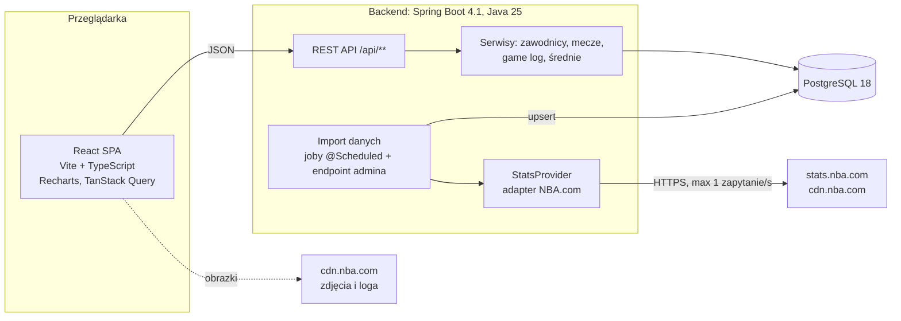
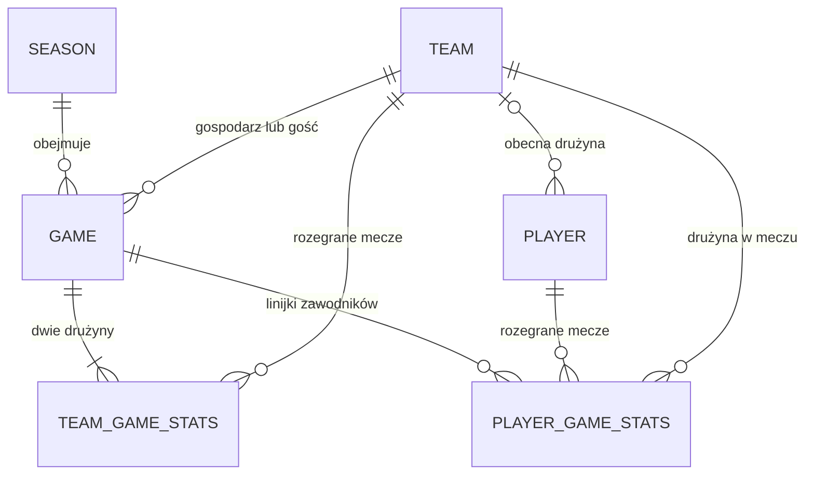

# StatTracker — plan aplikacji

> Stan na 6 listopada 2026 r. Wyniki z sekcji 2 pochodzą z rzeczywistych zapytań wysłanych z tego komputera (łącze domowe w Polsce).

## 1. Cel i zakres

Aplikacja webowa do śledzenia statystyk zawodników NBA i sprawdzania, jak często zawodnik przekracza zadaną linię (np. 14.5 pkt).

### MVP

1. Wybór zawodnika (wyszukiwarka z podpowiedziami), statystyki i linii (krok 0.5).
2. Wykres słupkowy ostatnich N meczów (5 / 10 / 15 / 20 / 30) z poziomą linią. Słupek powyżej linii jest zielony, poniżej czerwony, a równy linii (możliwe tylko przy liniach całkowitych) szary. Pod wykresem: liczba trafień (np. 13/20), procent, średnia i mediana.
3. Najechanie na słupek pokazuje pełny box score meczu: obie drużyny, każdy zawodnik (MIN, PTS, REB, AST, 3PM, FG, FT, STL, BLK, TOV, PF, +/-) i sumy drużyn. Kliknięcie przypina box score.
4. Średnie zawodnika z bieżącego i wszystkich poprzednich sezonów (sezon zasadniczy i playoffy osobno).

### Statystyki

- Podstawowe: PTS, REB, AST, 3PM, STL, BLK, TOV, FGM, FGA, FTM, FTA, OREB, DREB, MIN.
- Łączone: PTS+REB+AST, PTS+REB, PTS+AST, REB+AST, STL+BLK. Liczymy je w locie z linijki meczowej i nie zapisujemy w bazie.

### Poza MVP (fazy 4–5)

Splity (dom/wyjazd, przeciwko konkretnemu rywalowi), filtr minimalnych minut, DNP i kontuzje, predykcja prawdopodobieństwa przekroczenia linii, linie bukmacherskie.

## 2. Źródła danych

### 2.1 Wyniki testów

| Źródło | Wynik testu | Werdykt |
|---|---|---|
| **stats.nba.com** (API strony nba.com/stats) | 200 OK w 0,3–3 s, ale tylko z pełnym zestawem nagłówków przeglądarki. Bez nagłówków `Sec-Fetch-*` serwer nie odpowiada (timeout albo zerwane połączenie). | **Główne źródło** |
| **cdn.nba.com** (`liveData`, `staticData`) | 200 z nagłówkami przeglądarki, bez nich 403 (Akamai „Access Denied”). Box score dostępne co najmniej od sezonu 2019-20; 2017-18 i starsze zwracają 403. | Uzupełnienie: terminarz, szczegóły box score |
| **ESPN** (`site.api.espn.com`) | 200 bez nagłówków i bez klucza: terminarz, pełny box score meczu, game log zawodnika. | Źródło zapasowe (inne ID niż NBA) |
| **Sofascore** (`www.sofascore.com/api/v1`, `api.sofascore.com`) | 403 na każde zapytanie, także na `robots.txt` i z nagłówkiem `X-Requested-With`. Sofascore oficjalnie nie udostępnia danych przez API (umowy z dostawcami danych), a regulamin zakazuje automatycznego pobierania treści. | Odpada |
| **Flashscore** | Strona i feed odpowiadają (feed `global.flashscore.ninja` wymaga nagłówka `x-fsign`), ale to nieudokumentowany, zastrzeżony format tekstowy z separatorami `¬` i `÷`. `robots.txt` blokuje m.in. `/basketball/live/` i `/basketball/finished/`. | Odpada |
| **Basketball-Reference** | Strony HTML działają, ale `robots.txt` zawiera `Disallow: */gamelog/`. | Odpada |
| **balldontlie** | 401 bez klucza. Plan darmowy: tylko drużyny, zawodnicy i mecze (5 zapytań/min). ALL-STAR (9,99 USD/mies.): statystyki zawodników z meczów. GOAT (39,99 USD/mies.): box score, średnie sezonowe, kursy i player props. | Płatna, legalna alternatywa |
| **API-Sports** | 403 „Missing application key” — wymaga konta. | Nie badane głębiej |

### 2.2 Wnioski

- Głównym źródłem jest NBA.com. Endpoint `leaguegamelog` w jednym zapytaniu zwraca linijki wszystkich zawodników ze wszystkich meczów sezonu. To wystarcza do wykresu, box score i średnich.
- stats.nba.com i cdn.nba.com używają tych samych identyfikatorów (`PERSON_ID`, `TEAM_ID`, `GAME_ID`), więc łączenie danych z obu nie wymaga mapowania.
- ESPN zostaje jako zapas, gdyby NBA zablokowało dostęp. Ma inne ID, więc mecze trzeba by mapować po dacie i drużynach.

### 2.3 Nagłówki wymagane przez NBA.com

```text
User-Agent: Mozilla/5.0 (Windows NT 10.0; Win64; x64) AppleWebKit/537.36 (KHTML, like Gecko) Chrome/141.0.0.0 Safari/537.36
Accept: application/json, text/plain, */*
Accept-Language: en-US,en;q=0.9
Referer: https://www.nba.com/
Origin: https://www.nba.com
Sec-Fetch-Dest: empty
Sec-Fetch-Mode: cors
Sec-Fetch-Site: same-site
```

- Bez `Sec-Fetch-*` stats.nba.com nie odpowiada wcale (czeka do timeoutu), więc klient musi mieć twarde timeouty.
- Nagłówki `x-nba-stats-origin` / `x-nba-stats-token` ze starszych poradników nie są potrzebne.
- Dla cdn.nba.com żaden pojedynczy nagłówek nie wystarcza — wysyłamy cały zestaw.
- Zdjęcia zawodników (`https://cdn.nba.com/headshots/nba/latest/1040x760/{playerId}.png`) i loga drużyn (`https://cdn.nba.com/logos/nba/{teamId}/global/L/logo.svg`) działają bez dodatkowych nagłówków, więc frontend ładuje je bezpośrednio.

### 2.4 Endpointy, których użyjemy

| Endpoint | Do czego | Zmierzone |
|---|---|---|
| `stats.nba.com/stats/leaguegamelog?PlayerOrTeam=P&Season=2025-26&SeasonType=Regular%20Season&Counter=0&DateFrom=&DateTo=&Direction=DESC&LeagueID=00&Sorter=DATE` | linijki wszystkich zawodników z całego sezonu | 2025-26: 26 651 wierszy, 1 230 meczów, 582 zawodników; 4,5 MB (1 MB gzip), 3 s |
| ten sam endpoint z `PlayerOrTeam=T` | mecze i statystyki drużyn | 2025-26: 2 460 wierszy = 1 230 meczów |
| ten sam endpoint z `SeasonType=Playoffs` / `SeasonType=PlayIn` | fazy posezonowe | Play-In 2025-26: 6 meczów (ID z prefiksem `005`) |
| ten sam endpoint dla starszych sezonów | historia | 2003-04: 23 894 wiersze, 1 189 meczów |
| `stats.nba.com/stats/playerindex?Historical=1&LeagueID=00&Season=2026-27&SeasonType=Regular%20Season&TeamID=0&College=&Country=&DraftPick=&DraftRound=&DraftYear=&Height=&Weight=` | zawodnicy: drużyna, pozycja, numer, wzrost, waga, kraj, draft, status | `Historical=1`: 5 196 zawodników (pokrywa 100% graczy z logów 2003-04 i 2025-26); `Historical=0`: 525 |
| `stats.nba.com/stats/playercareerstats?PlayerID={id}&PerMode=PerGame&LeagueID=00` | oficjalne średnie per sezon — do weryfikacji naszych wyliczeń | 14 zestawów (sezon zasadniczy, playoffy, kariera, rekordy) |
| `stats.nba.com/stats/boxscoretraditionalv3?GameID={id}&StartPeriod=0&EndPeriod=0&StartRange=0&EndRange=0&RangeType=0` | box score z DNP (`comment: "DNP - Coach's Decision"`) i minutami `36:42` | ok. 20 KB na mecz |
| `cdn.nba.com/static/json/staticData/scheduleLeagueV2.json` | terminarz sezonu (ID meczów, godziny UTC) | 2026-27: 1 274 mecze (67 przedsezonowych, 1 206 sezonu zasadniczego, finał NBA Cup) |
| `cdn.nba.com/static/json/liveData/boxscore/boxscore_{gameId}.json` | box score: starter, DNP z powodem, minuty `PT45M15.10S`, wyniki kwart | od 2019-20 |

Pełny import historii od 2003-04 to ok. 110 zapytań.

### 2.5 Ograniczenia i ryzyka

- **Nieoficjalne API.** NBA może bez ostrzeżenia zmienić parametry albo zaostrzyć ochronę. Dlatego dostęp do danych schowamy za interfejsem `StatsProvider` (żeby dało się podmienić źródło na ESPN lub balldontlie), testujemy na zapisanych prawdziwych odpowiedziach, a każde uruchomienie importu logujemy w tabeli `ingestion_run`.
- **Limity zapytań nie są opublikowane.** Wysyłamy najwyżej 1 zapytanie na sekundę, sekwencyjnie. Codzienna synchronizacja to kilka zapytań.
- **Serwer „wisi” zamiast zwrócić błąd**, gdy coś mu się nie podoba. Klient musi mieć timeouty i ponawianie z rosnącym odstępem.
- **Adresy IP chmur.** Według zgłoszeń społeczności (biblioteka `nba_api`) stats.nba.com często blokuje adresy AWS, GCP i Azure. Import uruchamiamy lokalnie; przy hostingu w chmurze trzeba to sprawdzić osobno.

### 2.6 Regulamin NBA.com

Regulamin NBA.com (sekcja o „NBA Statistics”) pozwala używać statystyk wyłącznie do celów prywatnych i niekomercyjnych albo dziennikarskich, wymaga widocznej atrybucji „NBA.com” i zabrania m.in. użycia:

- w związku z jakimkolwiek hazardem, także legalnym (pkt iv),
- w grach fantasy i produktach komercyjnych (pkt v),
- w serwisie z regularnie aktualizowaną bazą statystyk NBA bez zgody NBA (pkt vii).

Co to oznacza dla projektu:

- Prywatne narzędzie uruchamiane lokalnie mieści się w „private, non-commercial”, ale analiza linii bukmacherskich formalnie podpada pod zakaz z pkt (iv). Przy prywatnym użyciu realne ryzyko jest niskie (najgorszy scenariusz to blokada dostępu), ale decyzja należy do Ciebie.
- Publikacja aplikacji w internecie lub komercjalizacja wymaga licencjonowanego źródła (np. balldontlie, SportsDataIO albo Sportradar — oficjalny dostawca danych NBA). Adapter `StatsProvider` to przewiduje.
- W stopce aplikacji umieszczamy „Dane: NBA.com”.

## 3. Architektura systemu



Zasady:

- **Frontend rozmawia tylko z naszym backendem.** Przeglądarka i tak nie mogłaby wołać stats.nba.com bezpośrednio (CORS, wymagane nagłówki). Wyjątkiem są zdjęcia i loga ładowane prosto z cdn.nba.com.
- **Dane trzymamy u siebie** (import do PostgreSQL) zamiast przepuszczać zapytania na żywo do NBA. NBA odpowiada wolno i nieprzewidywalnie, a my potrzebujemy szybkich agregatów i w przyszłości danych do modeli.
- **Jeden backend (modularny monolit)** z pakietami per funkcja. Import działa w tym samym procesie jako zaplanowane zadania — przy tej skali osobna usługa nie jest potrzebna.

### 3.1 Backend

| Obszar | Wybór | Uzasadnienie |
|---|---|---|
| Język i framework | Java 25 (LTS), Spring Boot 4.1, Maven Wrapper | aktualne LTS; wrapper — nie trzeba instalować Mavena |
| REST | Spring Web MVC, rekordy jako DTO, Bean Validation, błędy jako `ProblemDetail` | standard Springa |
| Dostęp do bazy | Spring JDBC (`JdbcClient`) + Flyway | dominują masowe upserty i zapytania agregujące, więc czysty SQL jest prostszy niż JPA |
| Klient NBA | `RestClient` na Apache HttpClient 5 | automatyczna dekompresja gzip (1 MB zamiast 4,5 MB na sezon), timeouty |
| Odporność | `@Retryable` ze Spring Framework 7 (backoff) + własny throttling 1 zapytanie/s | bez dodatkowych bibliotek |
| Dokumentacja API | springdoc-openapi (Swagger UI) | z niej generujemy typy TypeScript dla frontendu |
| Monitoring | Spring Boot Actuator + tabela `ingestion_run` | widać, kiedy import się nie udał |
| Testy | JUnit 5, AssertJ, Testcontainers (PostgreSQL 18), WireMock, prawdziwe odpowiedzi NBA jako fixtures | testy bez sieci, na realnych danych |

### 3.2 Import danych

Import sezonu (każdy krok idempotentny: `INSERT … ON CONFLICT DO UPDATE`):

1. **Drużyny** — 30 franczyz z konferencją i dywizją jako migracja `V2__teams.sql`. `TEAM_ID` franczyzy się nie zmienia (np. Seattle → Oklahoma City).
2. **Zawodnicy** — `playerindex` z `Historical=1` przy pierwszym imporcie; codziennie `Historical=0` aktualizuje drużynę i status.
3. **Mecze** — `leaguegamelog` drużyn (`PlayerOrTeam=T`). Z dwóch wierszy na mecz powstaje rekord `game` i dwa rekordy `team_game_stats`. Gospodarza i gościa rozpoznajemy po `MATCHUP`: `OKC vs. HOU` to gospodarz, `MIA @ LAC` to gość.
4. **Linijki zawodników** — `leaguegamelog` zawodników (`PlayerOrTeam=P`) → `player_game_stats`.
5. **Fazy sezonu** — osobne zapytania dla `Regular Season`, `PlayIn` i `Playoffs`. Mecze przedsezonowe i finał NBA Cup (ID z prefiksem `006`, nie wlicza się do statystyk sezonu) pomijamy.

| Zadanie | Kiedy (Europe/Warsaw) | Zapytania |
|---|---|---|
| Import historii | ręcznie: `POST /api/admin/ingestion/backfill?from=2003-04` | ok. 110, kilka minut |
| Pełne odświeżenie bieżącego sezonu (nadpisuje też korekty statystyk) | codziennie 09:00 i 15:00 — mecze kończą się u nas ok. 3:00–7:30 | 2–6 |
| Aktualizacja zawodników (transfery, debiutanci) | codziennie 09:00 | 1 |

Szczegóły, o których trzeba pamiętać w kodzie:

- Odpowiedź stats.nba.com ma postać `resultSets[].headers` + `rowSet`. Parser mapuje kolumny po nazwach, nie po pozycjach.
- `MIN` w game logu to pełne minuty (liczba całkowita). Procenty (`FG_PCT` itd.) bywają puste przy zerze prób — nie zapisujemy ich, liczymy z sum.
- `GAME_DATE` w `leaguegamelog` ma format `2026-11-04` (inne endpointy, np. `playergamelog`, zwracają `Apr 08, 2026`).
- Pierwszy import zapisze prawdziwe odpowiedzi do `src/test/resources/nba-fixtures`; na nich testujemy mapery.

### 3.3 Frontend

| Obszar | Wybór |
|---|---|
| Build | Vite 8, React 19, TypeScript 7 |
| Dane z API | TanStack Query 5 (cache; box score zakończonego meczu się nie przeterminowuje) |
| Routing i stan w URL | React Router 8: `/players/1628983?stat=PTS&line=14.5&n=20` — widok przetrwa odświeżenie i da się go zapisać |
| Wykres | Recharts 3: `BarChart` + `Cell` (kolor słupka) + `ReferenceLine` (linia) + `onMouseEnter` (hover) |
| Tabele | TanStack Table (sortowanie box score i średnich) |
| UI | Tailwind CSS 4 + shadcn/ui (combobox wyszukiwarki, selecty, zakładki) |
| Typy API | `openapi-typescript` + `openapi-fetch` — typy generowane z OpenAPI backendu |
| Dev | proxy Vite `/api` → `http://localhost:8080` (bez konfiguracji CORS) |
| Testy | Vitest + Testing Library, MSW do mockowania API |

## 4. Baza danych

### 4.1 Model



### 4.2 Schemat (`V1__schema.sql`)

```sql
CREATE EXTENSION IF NOT EXISTS pg_trgm;

CREATE TABLE season (
    id          VARCHAR(7) PRIMARY KEY,               -- '2026-27'
    start_year  SMALLINT   NOT NULL UNIQUE,           -- 2026
    is_current  BOOLEAN    NOT NULL DEFAULT FALSE
);

CREATE TABLE team (
    id            BIGINT      PRIMARY KEY,            -- NBA TEAM_ID, np. 1610612760
    abbreviation  VARCHAR(3)  NOT NULL UNIQUE,        -- obecny skrót, np. 'OKC'
    city          VARCHAR(40) NOT NULL,
    name          VARCHAR(40) NOT NULL,               -- 'Thunder'
    conference    VARCHAR(4)  NOT NULL,               -- 'East' / 'West'
    division      VARCHAR(10) NOT NULL
);

CREATE TABLE player (
    id               BIGINT       PRIMARY KEY,        -- NBA PERSON_ID, np. 1628983
    first_name       VARCHAR(60)  NOT NULL,
    last_name        VARCHAR(60)  NOT NULL,
    full_name        VARCHAR(120) NOT NULL,           -- 'Nikola Jokić'
    search_name      VARCHAR(120) NOT NULL,           -- 'nikola jokic': małe litery, bez diakrytyków (liczone w Javie)
    position         VARCHAR(5),                      -- 'G', 'F-C'
    jersey_number    VARCHAR(3),
    height           VARCHAR(5),                      -- '6-6'
    weight_lbs       SMALLINT,
    country          VARCHAR(60),
    draft_year       SMALLINT,
    current_team_id  BIGINT REFERENCES team (id),
    is_active        BOOLEAN      NOT NULL,
    from_year        SMALLINT,
    to_year          SMALLINT,
    updated_at       TIMESTAMPTZ  NOT NULL DEFAULT now()
);
CREATE INDEX ix_player_search_name ON player USING gin (search_name gin_trgm_ops);

CREATE TABLE game (
    id            VARCHAR(10) PRIMARY KEY,            -- NBA GAME_ID, np. '0022600186'
    season_id     VARCHAR(7)  NOT NULL REFERENCES season (id),
    season_type   VARCHAR(10) NOT NULL CHECK (season_type IN ('REGULAR', 'PLAY_IN', 'PLAYOFFS')),
    game_date     DATE        NOT NULL,               -- data w USA (US/Eastern), jak na NBA.com
    home_team_id  BIGINT      NOT NULL REFERENCES team (id),
    away_team_id  BIGINT      NOT NULL REFERENCES team (id),
    home_score    SMALLINT,
    away_score    SMALLINT,
    status        VARCHAR(10) NOT NULL DEFAULT 'FINAL',   -- SCHEDULED | FINAL (SCHEDULED dopiero z terminarzem, faza 4)
    updated_at    TIMESTAMPTZ NOT NULL DEFAULT now()
);
CREATE INDEX ix_game_date ON game (game_date);

CREATE TABLE team_game_stats (
    game_id            VARCHAR(10) NOT NULL REFERENCES game (id),
    team_id            BIGINT      NOT NULL REFERENCES team (id),
    team_abbreviation  VARCHAR(3)  NOT NULL,          -- skrót z dnia meczu, np. 'SEA', 'NJN'
    is_home            BOOLEAN     NOT NULL,
    win                BOOLEAN     NOT NULL,
    minutes            SMALLINT    NOT NULL,          -- 240 = bez dogrywki
    pts  SMALLINT NOT NULL, reb  SMALLINT NOT NULL, ast  SMALLINT NOT NULL,
    fgm  SMALLINT NOT NULL, fga  SMALLINT NOT NULL,
    fg3m SMALLINT NOT NULL, fg3a SMALLINT NOT NULL,
    ftm  SMALLINT NOT NULL, fta  SMALLINT NOT NULL,
    oreb SMALLINT NOT NULL, dreb SMALLINT NOT NULL,
    stl  SMALLINT NOT NULL, blk  SMALLINT NOT NULL,
    tov  SMALLINT NOT NULL, pf   SMALLINT NOT NULL,
    plus_minus SMALLINT,
    PRIMARY KEY (game_id, team_id)
);

CREATE TABLE player_game_stats (
    game_id         VARCHAR(10) NOT NULL REFERENCES game (id),
    player_id       BIGINT      NOT NULL REFERENCES player (id),
    team_id         BIGINT      NOT NULL REFERENCES team (id),
    is_starter      BOOLEAN,                          -- NULL do czasu wzbogacenia z box score (faza 4)
    seconds_played  INTEGER     NOT NULL,             -- z game logu MIN × 60; dokładne po wzbogaceniu
    pts  SMALLINT NOT NULL, reb  SMALLINT NOT NULL, ast  SMALLINT NOT NULL,
    fgm  SMALLINT NOT NULL, fga  SMALLINT NOT NULL,
    fg3m SMALLINT NOT NULL, fg3a SMALLINT NOT NULL,
    ftm  SMALLINT NOT NULL, fta  SMALLINT NOT NULL,
    oreb SMALLINT NOT NULL, dreb SMALLINT NOT NULL,
    stl  SMALLINT NOT NULL, blk  SMALLINT NOT NULL,
    tov  SMALLINT NOT NULL, pf   SMALLINT NOT NULL,
    plus_minus SMALLINT,
    source          VARCHAR(20) NOT NULL,             -- 'NBA_GAMELOG' | 'NBA_BOXSCORE'
    updated_at      TIMESTAMPTZ NOT NULL DEFAULT now(),
    PRIMARY KEY (game_id, player_id)
);
CREATE INDEX ix_player_game_stats_player ON player_game_stats (player_id);

CREATE TABLE ingestion_run (
    id             BIGSERIAL   PRIMARY KEY,
    job            VARCHAR(30) NOT NULL,              -- BACKFILL | DAILY_SYNC | PLAYERS_SYNC
    params         JSONB,                             -- np. {"season": "2025-26", "seasonType": "PLAYOFFS"}
    status         VARCHAR(10) NOT NULL,              -- RUNNING | SUCCESS | FAILED
    started_at     TIMESTAMPTZ NOT NULL DEFAULT now(),
    finished_at    TIMESTAMPTZ,
    rows_upserted  INTEGER,
    error          TEXT
);
```

### 4.3 Średnie sezonowe

```sql
CREATE VIEW player_season_averages AS
SELECT pgs.player_id,
       g.season_id,
       g.season_type,
       COUNT(*)                                                    AS games_played,
       ROUND(AVG(pgs.seconds_played) / 60.0, 1)                    AS minutes,
       ROUND(AVG(pgs.pts), 1)                                      AS pts,
       ROUND(AVG(pgs.reb), 1)                                      AS reb,
       ROUND(AVG(pgs.ast), 1)                                      AS ast,
       ROUND(AVG(pgs.fg3m), 1)                                     AS fg3m,
       ROUND(AVG(pgs.stl), 1)                                      AS stl,
       ROUND(AVG(pgs.blk), 1)                                      AS blk,
       ROUND(AVG(pgs.tov), 1)                                      AS tov,
       ROUND(SUM(pgs.fgm)::numeric  / NULLIF(SUM(pgs.fga), 0), 3)  AS fg_pct,
       ROUND(SUM(pgs.fg3m)::numeric / NULLIF(SUM(pgs.fg3a), 0), 3) AS fg3_pct,
       ROUND(SUM(pgs.ftm)::numeric  / NULLIF(SUM(pgs.fta), 0), 3)  AS ft_pct
FROM player_game_stats pgs
JOIN game g ON g.id = pgs.game_id
GROUP BY pgs.player_id, g.season_id, g.season_type;
```

Rozbicie na drużyny (zawodnik przeniesiony w trakcie sezonu) to to samo zapytanie z dodatkowym `GROUP BY pgs.team_id`.

### 4.4 Uwagi do modelu

- Klucze główne to identyfikatory NBA, więc import ze stats.nba.com i z cdn.nba.com trafia w te same rekordy. Przy innym dostawcy (ESPN, balldontlie) dojdzie tabela mapowań `external_id`.
- `player_game_stats` zawiera tylko mecze, w których zawodnik zagrał. Dzięki temu „ostatnie N meczów” i średnie to proste zapytania. DNP i nieobecności trafią do osobnej tabeli w fazie 4.
- Statystyk łączonych (PRA itd.) i procentów nie zapisujemy — liczymy je z sum.
- `game_date` to data amerykańska. Mecz z wieczoru 4.11 w USA to u nas noc z 4 na 5.11.
- Skrót drużyny z dnia meczu (`SEA`, `NJN`) trzymamy w `team_game_stats`, żeby historyczne box score wyglądały tak jak wtedy.
- Średnie są zwykłym widokiem SQL. Zawodnik ma w historii najwyżej ok. 2 tys. linijek, więc agregacja trwa milisekundy; widok zmaterializowany dodamy dopiero, gdy pomiary pokażą potrzebę.
- Skala: od 2003-04 ok. 650 tys. wierszy w `player_game_stats` (sam 2025-26 to 26 651), czyli rzędu 100–200 MB z indeksami.

### 4.5 Tabele w kolejnych fazach

- `player_game_absence` — DNP i nieobecności z powodem (faza 4, z box score CDN).
- `game_period_score` — wyniki kwart (faza 4).
- `tracked_line` — zapisane przez Ciebie linie i ich rozliczenie po meczu (faza 4).
- `projection` — prognozy: wartość oczekiwana, odchylenie, P(over), wersja modelu (faza 5).

## 5. REST API

| Metoda i ścieżka | Opis |
|---|---|
| `GET /api/players?query=gilg&limit=10` | wyszukiwarka (podobieństwo trigramowe, aktywni zawodnicy wyżej) |
| `GET /api/players/{playerId}` | profil: imię i nazwisko, drużyna, pozycja, numer, wzrost, waga |
| `GET /api/players/{playerId}/games?limit=100` | ostatnie rozegrane mecze (od najnowszego) z pełną linijką; frontend sam wybiera N i statystykę |
| `GET /api/players/{playerId}/season-averages?seasonType=REGULAR` | średnie per sezon, z rozbiciem na drużyny przy transferze |
| `GET /api/games/{gameId}/boxscore` | pełny box score obu drużyn z sumami |
| `POST /api/admin/ingestion/backfill?from=2003-04` | import historii |
| `POST /api/admin/ingestion/sync` | ręczne odświeżenie bieżącego sezonu |
| `GET /api/admin/ingestion/runs` | historia importów |

Endpoint game logu zwraca wszystkie statystyki naraz, bo wtedy zmiana statystyki albo linii (14.5 → 15.5) przelicza kolory od razu w przeglądarce, bez zapytania. 100 meczów to ok. 15 KB JSON-a.

Kształt odpowiedzi (typy wygenerowane z OpenAPI będą wyglądać mniej więcej tak):

```ts
type SeasonType = 'REGULAR' | 'PLAY_IN' | 'PLAYOFFS';

interface StatLine {
  minutes: number;
  pts: number; reb: number; ast: number;
  fgm: number; fga: number; fg3m: number; fg3a: number; ftm: number; fta: number;
  oreb: number; dreb: number; stl: number; blk: number; tov: number; pf: number;
  plusMinus: number | null;
}

interface PlayerGameLine extends StatLine {
  gameId: string;               // '0022600186'
  gameDate: string;             // '2026-11-04'
  seasonId: string;             // '2026-27'
  seasonType: SeasonType;
  isHome: boolean;
  teamAbbreviation: string;
  opponentAbbreviation: string;
  win: boolean;
  teamScore: number;
  opponentScore: number;
}

interface BoxScore {
  gameId: string;
  gameDate: string;
  seasonType: SeasonType;
  home: TeamBoxScore;
  away: TeamBoxScore;
}

interface TeamBoxScore {
  teamId: number;
  abbreviation: string;
  score: number;
  players: (StatLine & { playerId: number; name: string; isStarter: boolean | null })[];
  totals: StatLine;
}

interface SeasonAverage {
  seasonId: string;
  seasonType: SeasonType;
  teams: string[];              // np. ['DAL', 'LAL'] przy transferze w trakcie sezonu
  gamesPlayed: number;
  minutes: number;
  pts: number; reb: number; ast: number; fg3m: number; stl: number; blk: number; tov: number;
  fgPct: number | null; fg3Pct: number | null; ftPct: number | null;
}
```

## 6. Frontend — widok zawodnika

```text
+---------------------------------------------------------------------------+
| StatTracker                                   [ Szukaj zawodnika...     ] |
+---------------------------------------------------------------------------+
| [zdjęcie]  Imię Nazwisko   drużyna · pozycja · numer                      |
| Statystyka [Punkty v]   Linia [-] 14.5 [+]   Mecze [5|10|15|20|30]        |
| [x] Uwzględnij poprzedni sezon      Fazy [Sezon zasadniczy, Playoffy v]   |
+------------------------------------------------+--------------------------+
| Wykres: słupek = wartość statystyki,           | Box score meczu          |
| przerywana linia = 14.5,                       | (najechanie = podgląd,   |
| powyżej linii zielony, poniżej czerwony,       |  kliknięcie = przypięcie)|
| pionowy separator między sezonami              |                          |
|                                                | nagłówek: drużyny,       |
| L5 x/5   L10 x/10   L20 x/20   średnia  med.   | wynik, data; tabele obu  |
|                                                | drużyn + sumy            |
+------------------------------------------------+--------------------------+
| Średnie sezonowe     [Sezon zasadniczy | Playoffy]                        |
| Sezon | Drużyna | M | MIN | PTS | REB | AST | 3PM | STL | BLK | FG% | ... |
+---------------------------------------------------------------------------+
| Dane: NBA.com                                                             |
+---------------------------------------------------------------------------+
```

Logika statystyk w jednym miejscu (`frontend/src/lib/stats.ts`):

```ts
export const STATS = {
  PTS:  { label: 'Punkty',          value: (g: StatLine) => g.pts },
  REB:  { label: 'Zbiórki',         value: (g: StatLine) => g.reb },
  AST:  { label: 'Asysty',          value: (g: StatLine) => g.ast },
  FG3M: { label: 'Trafione trójki', value: (g: StatLine) => g.fg3m },
  PRA:  { label: 'Pkt + zb. + as.', value: (g: StatLine) => g.pts + g.reb + g.ast },
  // STL, BLK, TOV, PR, PA, RA, STL+BLK, FGM, FTM, MIN ...
} as const;

export type Outcome = 'over' | 'under' | 'push';

export const classify = (value: number, line: number): Outcome =>
  value > line ? 'over' : value < line ? 'under' : 'push';
```

Zachowanie widoku:

- Mecze na osi X chronologicznie (najstarszy po lewej), etykiety typu `@LAC 11/04` i `vs HOU 11/02`, wartość nad słupkiem.
- Gdy nie podano linii, domyślna to średnia z sezonu zaokrąglona do najbliższego x.5.
- Mecze z poprzedniego sezonu oddziela pionowa linia z etykietą sezonu; mecze playoff mają znacznik „PO”.
- Hover: `onMouseEnter` na słupku ustawia `hoveredGameId` z opóźnieniem ok. 100 ms (żeby przesuwanie myszy nie generowało serii zapytań) i uruchamia `useBoxScore(gameId)`. Dymek od razu pokazuje linijkę wybranego zawodnika (bez zapytania), a panel obok — pełny box score.
- Box score: dwie tabele (zawodnicy według minut, od fazy 4 najpierw starterzy) i wiersz sum. Wiersz wybranego zawodnika i kolumna wybranej statystyki są podświetlone.
- Średnie sezonowe: bieżący sezon na górze, kolumna wybranej statystyki podświetlona, przy transferze osobne wiersze dla drużyn.

## 7. Struktura repozytorium

```text
StatTracker/
├── backend/                               Spring Boot 4.1, Java 25, Maven Wrapper
│   ├── src/main/java/com/stattracker/
│   │   ├── player/                        wyszukiwarka, profil, game log, średnie
│   │   ├── game/                          box score
│   │   ├── ingestion/
│   │   │   ├── nba/                       klient HTTP, parser resultSets, rekordy wierszy
│   │   │   └── job/                       import historii, codzienna synchronizacja
│   │   └── common/                        konfiguracja, obsługa błędów
│   ├── src/main/resources/db/migration/   V1__schema.sql, V2__teams.sql
│   └── src/test/resources/nba-fixtures/   zapisane prawdziwe odpowiedzi NBA
├── frontend/                              Vite 8, React 19, TypeScript 7
│   └── src/
│       ├── api/                           typy z OpenAPI, klient, hooki TanStack Query
│       ├── features/
│       │   ├── player-search/
│       │   ├── prop-chart/                kontrolki, wykres, podsumowanie trafień
│       │   ├── box-score/
│       │   └── season-averages/
│       ├── lib/stats.ts                   definicje statystyk, classify()
│       └── pages/
├── docker-compose.yml                     PostgreSQL 18 (później także backend i frontend)
└── docs/PLAN.md
```

## 8. Plan realizacji

### Faza 0 — środowisko i szkielet

- Zainstalować: JDK 25 (np. Eclipse Temurin) — obecnie zainstalowana Java 23 nie dostaje już poprawek; Node.js 26 LTS; Docker Desktop (PostgreSQL i Testcontainers). Mavena ani Gradle nie trzeba — projekt dostanie wrapper.
- `git init`, `.gitignore`, katalogi z sekcji 7, `docker-compose.yml` z PostgreSQL 18.
- Backend ze Spring Initializr: Spring Boot 4.1.x, Java 25, Maven; zależności: Spring Web, JDBC API, Flyway, PostgreSQL Driver, Validation, Actuator, Testcontainers. Ręcznie: springdoc-openapi, httpclient5, WireMock.
- Frontend: `npm create vite@latest frontend -- --template react-ts`, Tailwind, shadcn/ui, proxy `/api`.

Gotowe, gdy: PostgreSQL, backend i frontend startują, a frontend pokazuje status backendu.

### Faza 1 — baza danych i import

1. Migracje `V1__schema.sql` (sekcja 4.2) i `V2__teams.sql`.
2. Klient NBA: nagłówki z sekcji 2.3, timeouty (połączenie 10 s, odczyt 60 s), throttling, retry, parser `resultSets`.
3. Zapis fixtures i testy maperów.
4. Import: zawodnicy → mecze i drużyny → linijki zawodników; endpoint importu historii, harmonogram, `ingestion_run`.
5. Test integracyjny (Testcontainers) porównujący nasze średnie z oficjalnymi z `playercareerstats`. Przykład zmierzony dziś: Shai Gilgeous-Alexander 2025-26 — 68 meczów, 31.1 PTS, 4.3 REB, 6.6 AST. Minuty porównujemy z tolerancją, bo game log podaje pełne minuty.

Gotowe, gdy: import od 2003-04 kończy się sukcesem, ponowne uruchomienie nie tworzy duplikatów, a test zgodności średnich przechodzi.

### Faza 2 — REST API

- Endpointy z sekcji 5, wyszukiwarka trigramowa, Swagger UI, błędy jako `ProblemDetail`.
- Testy MockMvc na Testcontainers.

Gotowe, gdy: wszystkie endpointy działają w Swagger UI na prawdziwych danych.

### Faza 3 — frontend MVP

- Typy i klient z OpenAPI, hooki TanStack Query.
- Wyszukiwarka, kontrolki, wykres z kolorami i linią, panel box score na hover, tabela średnich, stan w URL, atrybucja NBA.com.
- Testy `classify` i statystyk łączonych, test komponentu wykresu.

Gotowe, gdy: cały scenariusz z sekcji 1 działa od wyszukania zawodnika do box score.

### Faza 4 — rozszerzenia

- Wzbogacenie box score z cdn.nba.com (od 2019-20): starterzy, dokładne minuty, DNP z powodem, wyniki kwart.
- Terminarz z `scheduleLeagueV2`: najbliższy mecz, mecze dzień po dniu (back-to-back).
- Splity: dom/wyjazd, przeciwko rywalowi, filtr minimalnych minut, wykluczanie meczów przerwanych kontuzją.
- Zapisywanie własnych linii i automatyczne rozliczanie po meczu.
- Uruchamianie całości w Docker Compose.

### Faza 5 — predykcje

- Model bazowy: wartość oczekiwana = tempo na minutę (średnia ważona, nowsze mecze ważniejsze) × przewidywane minuty; P(wartość > linia) z rozkładu Poissona lub ujemnego dwumianowego (statystyki są dyskretne i często mają większą wariancję niż Poisson).
- Korekty: obrona i tempo rywala, dom/wyjazd, odpoczynek, forma.
- Backtest na historii z bazy: Brier score, krzywe kalibracji.
- Opcjonalnie linie bukmacherskie z licencjonowanego API (np. balldontlie GOAT): automatyczne podstawianie linii i porównanie z modelem.

## 9. Decyzje do potwierdzenia

1. **Początek sezonu.** Dziś zawodnicy mają w sezonie 2026-27 najwyżej 9 meczów (rozegrano 121 z 1 206; np. Gilgeous-Alexander ma 8), więc 15/20/30 meczów „w sezonie” jeszcze nie istnieje. Propozycja: domyślnie ostatnie N meczów z przejściem do poprzedniego sezonu (z separatorem na wykresie) i przełącznik „tylko bieżący sezon”.
2. **Prywatnie czy publicznie.** Plan zakłada prywatne narzędzie uruchamiane lokalnie — wtedy NBA.com wystarczy. Publikacja wymaga innego źródła danych (sekcja 2.6).
3. **Zakres historii.** Domyślnie od 2003-04 (ok. 110 zapytań, kilka minut). Można zacząć np. od 2019-20 i dociągnąć resztę później.
4. **Box score na hover** jako panel obok wykresu (najechanie = podgląd, kliknięcie = przypięcie), a nie duży dymek, który zasłaniałby wykres i znikał przy próbie przewinięcia tabeli.
5. **Playoffy w „ostatnich N meczach”** — domyślnie wliczone (ze znacznikiem), z możliwością wyłączenia.
